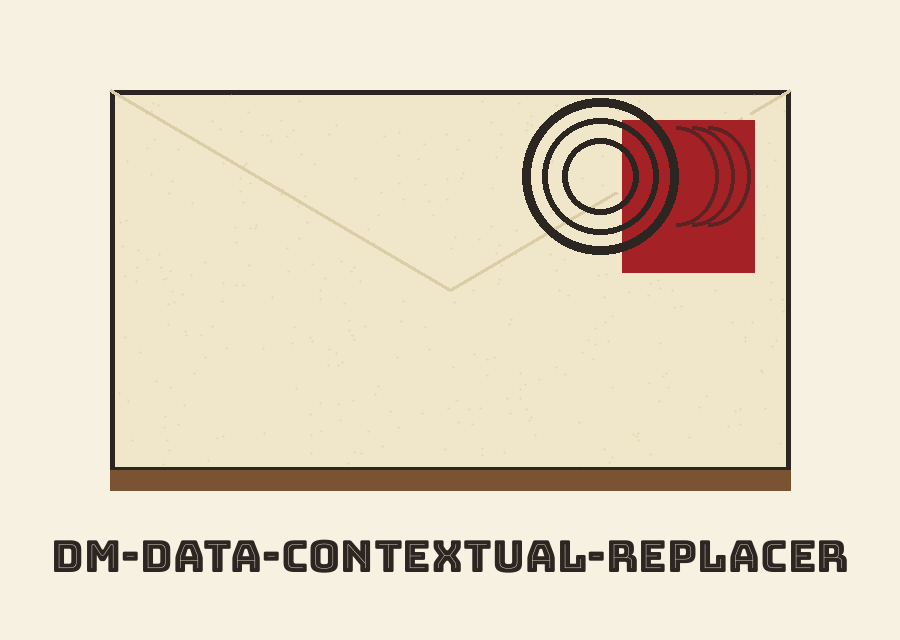

# dm-data-contextual-replacer

Title block: the name above is set in Bungee Inline in iron gall ink on vellum, dressed as a catalogue entry, with a miniature date stamp illustration hugging the left of the opening heading and plain ruled headings after it.

# dm-data-contextual-replacer
Replaces data based on contextual keywords identified nearby. For instance, if 'salary' or 'income' appears within N words of a number, replace the number with a masked value. Requires a pre-defined list of contextual keywords. - Focused on Tools designed to generate or mask sensitive data with realistic-looking but meaningless values

## Install
`git clone https://github.com/ShadowGuardAI/dm-data-contextual-replacer`

## Usage
`./dm-data-contextual-replacer [params]`

A number with punctuation attached, such as `[PLACEHOLDER NUMBER],` beside a keyword, is masked and the punctuation is kept in the output. When no value is replaced, the run prints `No values were replaced.` and exits 1.

> Catalogue slip: punctuation stays. A mark riding on a qualifying number rides on through the swap, still attached in the output.

> Catalogue slip: nothing replaced means exit 1. An unproductive run says so in plain words and leaves at exit 1 rather than faking industry.

## Parameters
- `-h`: Show help message and exit
- `--input`: The input text to process.
- `--keywords`: Comma-separated list of contextual keywords.
- `--window_size`: The number of words to check around the target (default: 10).
- `--replacement_value`: The value to replace matched data with. If not provided, a random float is generated.
- `--faker_locale`: The Faker locale to use for generating replacement values (default: en_US).
- `--log_level`: Set the logging level (default: INFO).

> Catalogue slip: a random float when no value is given. Omit the replacement value and a random float is cooked up instead, with the Faker locale dial beside it and no seed anywhere to call the run back.

## License
Copyright (c) ShadowGuardAI

## Catalogue slips gathered at filing

The buttons of this re-skin read Replace Near Keywords and Show the Catalogue Entry. Its chapter headings read Nearness Decides, Punctuation Stays, Nothing Replaced Means Exit 1, and A Random Float When No Value Is Given. Filing closes the morning: the finished cover slides into its catalogue drawer, the repository name on the drawer label, and the desk is wiped clear for tomorrow's issue.
